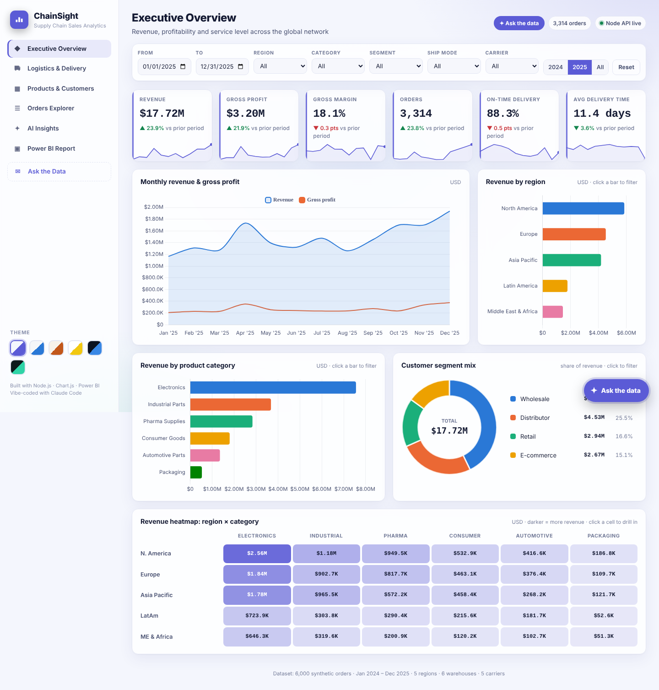
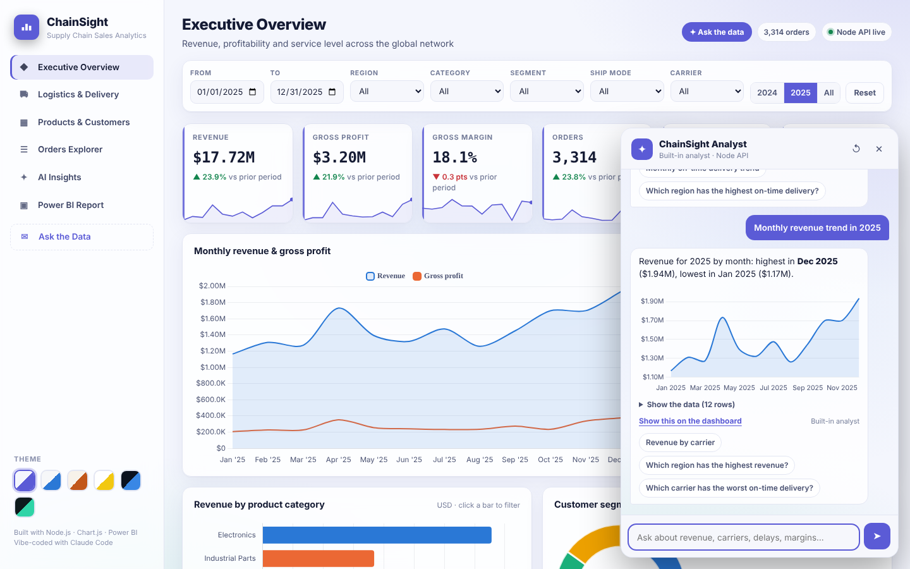

# ChainSight — Supply Chain Sales Analytics

**Week 1 Project · The Gen Academy – Mastering Agentic AI (Oct 2026) · Path C: Build your own vibe-coded app**
Author: Bala Mallampati

A sales analytics dashboard for a **global supply chain and logistics business**, built through vibe coding with **Claude Code**.
It has two front ends that read the same dataset:

1. **Web portal**: a Node.js app with a REST API, 6 views, global filters, 5 themes, AI insights and CSV export.
2. **Power BI report**: a star-schema model, DAX measures and a matching theme. It is embedded in the portal through Publish-to-web.

🔗 **Live portal:** `https://balum211.github.io/BalaSalesAnalytics/` *(after GitHub Pages is enabled — see below)*
🔗 **Looker Studio (Data Studio) report — public:** https://datastudio.google.com/reporting/af6d4833-860b-468b-8e90-b47cda2962aa/page/tEnnC (embedded in the portal's *BI Report* tab)
🎥 **Demo video:** *add your Loom link here*





---

## Problem statement
An operations VP at a distributor that ships to 5 regions from 6 warehouses through 5 carriers needs answers to these questions:
- Are we growing, and is the growth profitable?
- Which carriers, ship modes and warehouses are hurting **on-time delivery (OTD)**?
- What does freight cost us as a share of revenue, and where can we cut it?
- Which products and customers drive revenue and margin?

Today these answers are spread across spreadsheets. ChainSight puts them in one filterable portal and a Power BI report.

## Features
| View | What it shows |
|---|---|
| **Executive Overview** | 6 KPI tiles (Revenue, Gross Profit, Margin %, Orders, OTD %, Avg Delivery Days) with change vs the prior period · monthly revenue and profit trend · revenue by region, category and segment |
| **Logistics & Delivery** | OTD % by carrier against a 90% target · promised vs actual lead time by ship mode · monthly OTD trend · freight % of revenue · warehouse performance table with status badges |
| **Products & Customers** | Top 10 products · gross margin by category · top-customer table |
| **Orders Explorer** | Search across order, customer, product, country and carrier · sortable columns · pagination · **Export CSV** of the filtered set |
| **AI Insights** | Automatically generated findings: growth, risks, cost levers. If `ANTHROPIC_API_KEY` is set, **Claude** writes the executive summary from aggregated metrics only (raw rows are never sent). |
| **Ask the Data (chatbot)** | Ask questions in plain English, such as "Which carrier has the worst on-time delivery?", "Compare Europe vs Asia Pacific profit" or "Monthly revenue trend in 2025". Answers come with a chart, a data table and a **Show this on the dashboard** button. With `ANTHROPIC_API_KEY` set, **Claude** answers by calling a `query_sales` tool that runs on the same KPI engine (an agentic tool-use loop). Without a key, a built-in analyst parses the question and runs the query in your browser. |
| **BI Report (Looker)** | Public **Looker Studio (Data Studio)** report embedded in the portal. It has a Google Maps bubble map of revenue by country (coloured by region), KPI scorecards with sparklines, date/region/carrier/category controls, a category donut, a monthly trend, on-time % by carrier, and a warehouse heatmap table. The data reaches it through a Google Sheet that `IMPORTDATA`s `data/looker_sales.csv` from this repo. |

- **Global filters** (date range, region, category, segment, ship mode, carrier) apply to every view. Quick buttons switch between 2024, 2025 and All.
- **Clear empty state** when no orders match the filters.
- **Interactive analysis**: click any bar, donut slice, heatmap cell or warehouse row to filter every view. Active filters appear as removable chips.
- **Rich visuals**: KPI tiles with sparklines, a region × category revenue heatmap, a segment donut, and target lines.
- **6 themes**: Horizon (default, light), Daylight, Sandstone, Corporate (Power BI style), Midnight and Aurora. The choice is remembered per browser.
- **Colorblind-checked chart palette**. Colors are tied to entities, so a region keeps its color when the filters change.
- **Responsive** down to phone width.
- **Zero runtime dependencies**: the server uses Node's built-in `http` module and Chart.js is vendored, so there's no `npm install` to fail.

## Tech stack
Node.js 18+ (built-in `http`) · Vanilla JS + Chart.js 4.4.1 · CSS custom-property themes · Power BI Desktop/Service + DAX · Claude Code (VS Code) as the AI pair-programmer · GitHub Actions → GitHub Pages

## Dataset
`data/supply_chain_sales.csv` holds 6,000 synthetic orders from Jan 2024 to Dec 2025. It is generated by `scripts/generate-data.js` with a fixed seed, so it is identical on every run.
The generator builds in realistic patterns: Q4 seasonality, 18% year-over-year growth, carrier reliability differences, Q4 congestion that lowers OTD, Pharma shipping by air more often, discounts that vary by segment, and returns and cancellations.

| Column | Description |
|---|---|
| order_id, order_date, ship_date, delivery_date | Order lifecycle |
| region, country, warehouse | Geography and fulfilment node |
| customer_segment, customer_name | Retail · Wholesale · E-commerce · Distributor |
| product_category, product_name | 6 categories, 27 products |
| ship_mode, carrier | Road · Ocean · Air · Rail; 5 fictional carriers |
| quantity, unit_price, discount | Order line |
| revenue, cogs, shipping_cost, gross_profit | USD. Revenue is 0 for returned or cancelled orders. |
| promised_days, actual_days, on_time | Service level |
| order_status | Delivered · In Transit · Returned · Cancelled |

## Run locally (VS Code)
```bash
git clone https://github.com/balum211/BalaSalesAnalytics.git
cd BalaSalesAnalytics
code .                 # open in VS Code
npm start              # → http://localhost:3000   (or press F5: "Run ChainSight server")
npm test               # API smoke tests
```
Optional: copy `.env.example` to `.env` and add `ANTHROPIC_API_KEY` to turn on Claude-written insights.

| Script | Purpose |
|---|---|
| `npm start` | Start the portal and API on :3000 |
| `npm run dev` | Same, but restarts automatically when files change |
| `npm run generate` | Regenerate the dataset |
| `npm run powerbi` | Rebuild the Power BI star-schema CSVs in `powerbi/data/` |
| `npm test` | Smoke-test every API endpoint |
| `node scripts/chat-test.js "your question"` | Try the built-in analyst from the terminal |

## REST API
| Endpoint | Returns |
|---|---|
| `GET /api/health` | Status, row count and whether AI is enabled |
| `GET /api/meta` | Date range and the distinct values of each dimension |
| `GET /api/kpis?region=Europe&from=2025-01-01` | KPI object for the filter |
| `GET /api/breakdown/:dimension` | KPIs grouped by `region`, `carrier`, `month`, `product_name`, and so on |
| `GET /api/orders?page=1&size=50&q=atlas` | Paged, filtered orders |
| `POST /api/insights` (JSON filters) | Insights (Claude if a key is set, rule-based otherwise) |
| `POST /api/chat` `{question, history}` | Chatbot answer (Claude with tool use if a key is set, built-in analyst otherwise) |

## Deploy the portal (GitHub Pages)
1. Push to `main`.
2. Go to **Settings → Pages → Source = GitHub Actions**. The workflow `.github/workflows/pages.yml` runs the tests and publishes `public/`.
3. The portal goes live at `https://balum211.github.io/BalaSalesAnalytics/`. On Pages it runs in *static mode*: every view and filter works in the browser. The Node API and Claude insights need `npm start` locally or a Node host such as Render or Railway.

## Power BI
See **[powerbi/POWERBI-GUIDE.md](powerbi/POWERBI-GUIDE.md)**. It covers the star schema (`powerbi/data/`), the measures in `DAX-measures.dax`, the theme in `ChainSight-theme.json`, the page layouts, and publishing.

## Project structure
```
├── server.js                  # Node HTTP server + REST API (+ optional Claude call)
├── public/                    # Web portal (also the GitHub Pages root)
│   ├── index.html
│   ├── css/styles.css         # 5 themes via CSS custom properties
│   ├── js/analytics.js        # Shared KPI engine (browser + Node)
│   ├── js/app.js              # Views, charts, filters, explorer, click-to-filter
│   ├── js/chat-engine.js      # NL question → query engine (browser + Claude tool)
│   ├── js/chat-ui.js          # Ask-the-data chat panel
│   ├── js/themes.js, config.js
│   ├── data/orders.json       # Dataset for the browser
│   └── vendor/chart.umd.js    # Chart.js 4.4.1 (MIT)
├── data/supply_chain_sales.csv
├── powerbi/                   # Theme, DAX, star-schema CSVs, build guide
├── scripts/                   # generate-data, build-powerbi-tables, smoke-test, screenshots
├── docs/                      # PROMPTS.md (vibe-coding log), screenshots
└── .github/workflows/pages.yml
```

## How it was built
The full prompt-by-prompt log, including bugs and iterations, is in **[docs/PROMPTS.md](docs/PROMPTS.md)**.
